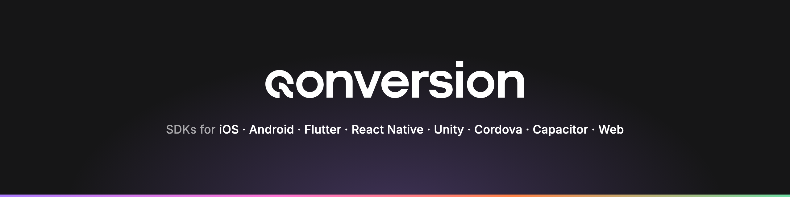

<p align="center"></p>

# Qonversion Web SDK

**Qonversion is the app growth system for people and agents.** It collects the revenue data of your
subscription app and keeps it lined up with what Stripe and Paddle report, so entitlements and
analytics run on the same numbers. This repository holds the Web SDK: the JavaScript part that runs
in the browser and sends web purchases to Qonversion, so a user who paid on the web gets access in
your mobile app too.

[](https://github.com/qonversion/web-sdk/releases)
[](https://www.npmjs.com/package/@qonversion/web-sdk)
[](LICENSE)
[](https://documentation.qonversion.io/docs/web-sdk)

## Quickstart

Create a project in the [dashboard](https://dash.qonversion.io) and connect Stripe or Paddle first — nothing validates until then.

**1. Install**

```bash
npm install @qonversion/web-sdk
```

**2. Initialize**

```typescript
import Qonversion, {QonversionConfigBuilder} from '@qonversion/web-sdk';

const config = new QonversionConfigBuilder('your_project_key').build();
const qonversion = Qonversion.initialize(config);
```

The project key is in the dashboard under **Settings → Developer → Keys**.

**3. Check what the user has access to**

```typescript
await qonversion.identify('your_user_id');

const entitlements = await qonversion.entitlements();

if (entitlements.some(e => e.id === 'premium' && e.active)) {
  // unlock premium features
}
```

Full walk-through and the Stripe and Paddle setup: [Web SDK](https://documentation.qonversion.io/docs/web-sdk).

## Documentation

* [Welcome](https://documentation.qonversion.io/docs/qonversion-platform) — what the platform does and the three ways to start.
* [Web SDK setup](https://documentation.qonversion.io/docs/web-sdk) — full installation and configuration.
* [Quick start](https://documentation.qonversion.io/docs/quickstart) — create a project, connect the stores.
* [API reference](https://documentation.qonversion.io/reference/v4/overview) — REST API v4.
* [For agents](https://documentation.qonversion.io/docs/for-agents) — MCP servers, machine-readable docs, ready-made prompts.

Payment providers: [Stripe](https://documentation.qonversion.io/docs/stripe-integration) ·
[Paddle](https://documentation.qonversion.io/docs/paddle-integration) ·
[sending a Paddle purchase](https://documentation.qonversion.io/docs/initiate-purchase-paddle).

## What this SDK does

* **Sends web purchases to Qonversion** — a completed Stripe or Paddle transaction, reported from the browser, becomes a purchase on the user's Qonversion profile.
* **Resolves entitlements** — one answer to "is this user premium right now", the same answer the mobile SDKs give for the same user.
* **Links the web user to your own user id** — `identify` and `logout`, so a purchase made on the web unlocks the app.
* **Carries user properties** — attributes you can segment and forward to your analytics and marketing platforms.
* **Feeds everything else** — analytics, cohorts, raw data export, webhooks and integrations read the same purchases.

What happens when something fails — the standby service, fallback files and the uptime commitment
behind the platform: [reliability](https://qonversion.io/reliability).

> This SDK does not make purchases itself and does not talk to StoreKit or Google Play Billing —
> the checkout stays with Stripe or Paddle, and the native purchase flow stays with the mobile SDKs.
> Remote Configs, A/B tests and dashboard-built screens are mobile-side features and are not part
> of this package.

## For agents

An agent can integrate this SDK end to end. The companion file [`AGENTS.md`](AGENTS.md) gives it the
current version, the documented method names and the rules it must not break, instead of what its
training data remembers.

**Read these docs as an agent.** The documentation exposes an MCP server at
`https://documentation.qonversion.io/mcp` — no account needed. Any page is available as markdown by
appending `.md` to its URL, and [`llms.txt`](https://documentation.qonversion.io/llms.txt) lists every page.

**Work on your project data as an agent.** The Qonversion MCP server at `https://mcp.qonversion.io/mcp`
exposes the platform's resources as tools. The agent authenticates as you over OAuth 2.1, each tool
is gated by its own scope, and no Qonversion key is handed to the model. Apple Ads tools need the
feature on your account (404 otherwise); campaign changes additionally need the `apple_ads:write`
scope and a team member with campaign-management permission — check
`get_apple_ads_connection_status`.

Destructive tools and Apple Ads changes that increase spend do not fire on the first call: they
return a short-lived token addressed to the human operator, and completing the action requires
echoing the resource id verbatim and giving a reason, which is recorded in the audit log. Pausing an
entity or lowering a value is **not** parked — it applies immediately. The full tool list, the
per-client setup and the scopes are in
[MCP Server](https://documentation.qonversion.io/docs/mcp-server).

**Have an agent integrate this SDK.** Paste this into Claude Code, Cursor, Codex or any coding agent
working in your app's repository:

> Integrate the Qonversion Web SDK into this web app.
>
> Read the official documentation before writing any code. The docs expose an MCP server at `https://documentation.qonversion.io/mcp` — use it if you can. Otherwise fetch pages directly; any page is available as markdown by appending `.md` to its URL, and `https://documentation.qonversion.io/llms.txt` lists every page.
>
> Steps:
> 1. Check with me that a Qonversion project exists and Stripe or Paddle is connected to it in the dashboard. Checkout stays with Stripe or Paddle; this SDK reports the completed purchases, and nothing arrives until the connection is done.
> 2. Read `https://documentation.qonversion.io/docs/web-sdk.md` and follow its steps and method names. Take the SDK version from the latest release tag or the npm registry, not from memory — the docs page can name an older one; if they disagree, tell me.
> 3. Install `@qonversion/web-sdk` and initialize it with the Qonversion project key. Ask me for the key; it is in the dashboard under Settings → Developer → Keys. Never commit it to the repository. The Web SDK has no launch modes — do not ask me to choose one.
> 4. Call `identify` with the user id this app uses, so a purchase made on the web unlocks the same user in the mobile app.
> 5. After a completed checkout, report it with `sendStripePurchase` or `sendPaddlePurchase`, then read `entitlements` to decide what the user can access.
> 6. Show me the diff and tell me what you could not verify against the docs.

Prefer to do it by hand? The steps are on the [Web SDK](https://documentation.qonversion.io/docs/web-sdk) page.

## Sample app

This package ships no sample app. Examples of `sendStripePurchase` and `sendPaddlePurchase` are on the
[Web SDK](https://documentation.qonversion.io/docs/web-sdk#purchases) page; the Paddle flow end to end
is on [sending a Paddle purchase](https://documentation.qonversion.io/docs/initiate-purchase-paddle).

## Requirements

| | Minimum |
|---|---|
| Runtime | any modern browser bundle; the package ships a CommonJS build and TypeScript types |
| Payment provider | a connected Stripe or Paddle account |

The package declares no `engines` floor — see `package.json`.

## Help

Contact us via [issues on GitHub](https://github.com/qonversion/web-sdk/issues) or the
[contact form](https://qonversion.io/contact-us) on our site.

## Contributing

Contributions are what make the open source community such an amazing place to learn, inspire, and create. Any contributions you make are **greatly appreciated**.

1. Fork the Project
2. Create your Feature Branch (`git checkout -b feature/SuperFeature`)
3. Commit your Changes. Use small commits with separate logic. (`git commit -m 'Add some super feature'`)
4. Push to the Branch (`git push origin feature/SuperFeature`)
5. Open a Pull Request

## License

Qonversion SDK is available under the MIT license. See [LICENSE](LICENSE).
